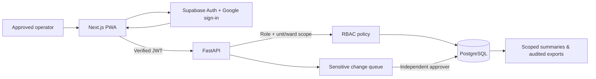

<div align="center">

# Uttara OMS
### Uttara Model Thana — Organizational Management System

**A private-by-default, bilingual-ready administrative platform for structured organizational records.**

[](apps/api)
[](apps/web)
[](docs/architecture.md)
[](docs/security.md)
[](https://github.com/hossain0707/uttara-oms/actions)

**Overview · Member records · Ward & unit hierarchy · Independent approvals · Reporting · Audit trail**

</div>

---

## Overview

Uttara OMS organizes administration across **Thana → Ward → Unit**, with four configurable organizational categories: **Rukon (রুকন), Worker (কর্মী), Associate (সহযোগী), Supporter (সমর্থক)**.

The repository is intentionally **application source only**. It must never contain real persons' records, political affiliations, phone numbers, credentials, encrypted database dumps or authorization tokens.

### Features in the initial implementation

| Domain | Capabilities |
| --- | --- |
| Dashboard | Current active counts by category; monthly increases/decreases; unit totals |
| Member records | Individual records; lookup by name, member ID and exact normalized phone; duplicate phone detection |
| Hierarchy | Editable Thana, Ward and Unit structure; initial 12 ward placeholders |
| Sensitive changes | Category, unit transfer, activation/deactivation require a submitted request and a separate approver |
| Security | Supabase Google SSO, backend JWT verification, explicit local user approval, scoped role grants, admin MFA enforcement |
| Data protection | Fernet encryption for phones/addresses, keyed HMAC phone deduplication, recorded consent attestation, no personal data in system logs |
| Audit | Append-only application audit/event entries; optimistic version checking for member edits |
| Reporting | Authorized aggregate Excel/PDF exports; admin-restricted personal Excel export with audit logging |
| Experience | Responsive Next.js web UI, mobile installable PWA manifest, accessible form controls |

### Architecture



### Authorization model: Option A + C

- **Thana Admin**: global scope, structural changes and approvals. Administrator MFA is required by default.
- **Thana Responsible Officer**: organization-wide aggregate reports only; cannot access personal profiles, search or individual approval queues.
- **Ward Admin**: read/write within a Ward and its units; approve non-self requests within that Ward.
- **Unit Responsible Officer**: read/write within assigned Unit; submit requests but cannot approve them.
- **Sensitive actions**: category/status/unit transfers are pending until approved by another authorized officer. Cross-ward transfers require Thana Admin approval.
- **Role provisioning**: first two administrators are bootstrapped offline; all subsequent role grants/revocations require a second administrator's independent approval via the Access control UI.

All permissions are rechecked by the backend; the frontend only provides a user interface.

## Repository layout

```
apps/
  api/
    app/               # Settings, models, JWT auth, RBAC and FastAPI routes
    alembic/           # Version-controlled SQL migrations
    tests/             # API and policy tests
    Dockerfile
  web/
    app/               # Dashboard, directory, structure, approvals, exports
    components/        # Authenticated responsive application shell
    lib/               # Typed API client, Supabase session integration
docs/
  architecture.md
  security.md
  operations.md
  qa.md
.github/workflows/
  ci.yml
docker-compose.yml
```

## Local setup

Requirements: Python 3.12+, Node 22+, Docker with Compose, PostgreSQL 16 (or hosted PostgreSQL), and a **dedicated Supabase project with Google login and asymmetric JWT signing enabled**.

1. Copy `apps/api/.env.example` to `apps/api/.env`; fill values with local-only secrets. Create an encryption key with `python -c "from cryptography.fernet import Fernet; print(Fernet.generate_key().decode())"`. Use a different long random key for `PHONE_HASH_KEY`.
2. Set `LOCAL_DB_PASSWORD` in your shell and run `docker compose up -d db`. Set `DATABASE_URL` to `postgresql+psycopg://oms:<password>@localhost:5434/oms` for local Python (or `@db:5432` inside Compose).
3. From `apps/api/`, install `pip install -r requirements.txt` and run `alembic upgrade head`.
4. Initialize **organizational nodes only**, no people: `python -m app.bootstrap init-org`.
5. Configure a dedicated Supabase Google OAuth project and permitted redirect URLs; sign in once with the intended admin Google account. Get the exact Supabase `auth.users.id` (JWT `sub`) through an authorized Supabase admin interface. Provision it locally with `python -m app.bootstrap admin --sub <auth-sub-uuid> --email <email>`. This is an offline privileged operation; enable Supabase MFA for this identity before using the app.
6. Run `uvicorn app.main:app --reload` in `apps/api/`.
7. Copy `apps/web/.env.example` to `apps/web/.env.local` and set the public Supabase project URL/publishable key and backend URL. From `apps/web/`, run `npm install && npm run dev`.
8. Open http://localhost:3000 and use Google sign-in. Only explicitly approved database accounts can enter.

**Important:** An OAuth sign-in alone never confers organizational access. Google identities are not accepted until a locally approved `app_users` record and scoped `role_grants` exist.

## Testing

```bash
cd apps/api
pytest -q

cd ../web
npm install
npm run lint
npm run build
```

See [architecture](docs/architecture.md), [security and privacy](docs/security.md), [operations](docs/operations.md), and [QA checklist](docs/qa.md).

## Release status

**Development foundation — not certified production-ready and not deployed.** The implementation must pass integration tests, a privacy/legal review, security review, deploy configuration, backup/restore exercise and acceptance testing before real data is imported. The current repository does not provide production secrets or an active hosting endpoint.

The software must be used for consensual internal administration, **not** individual political profiling, campaign targeting, or unauthorized sharing of personal data.

**License:** No open-source license has been granted. All rights reserved by the repository rights holder unless a separate license is supplied.
