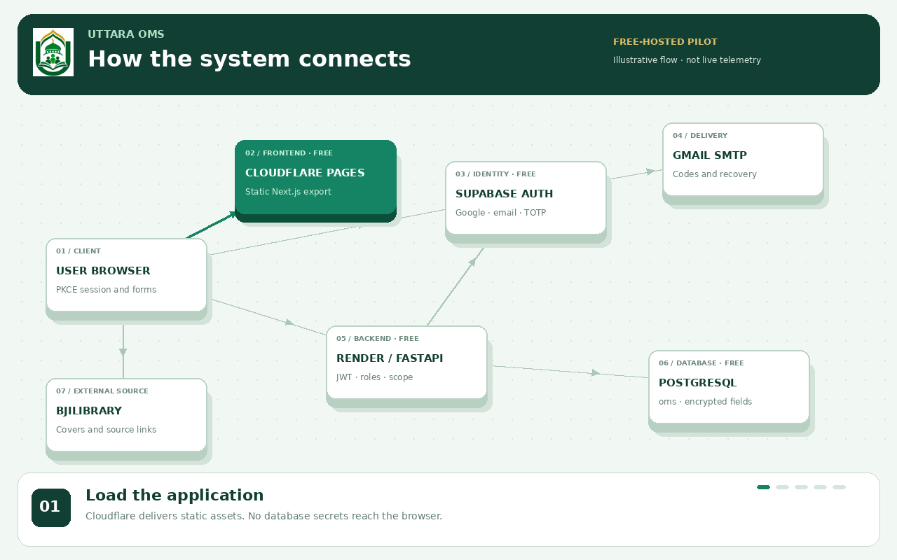
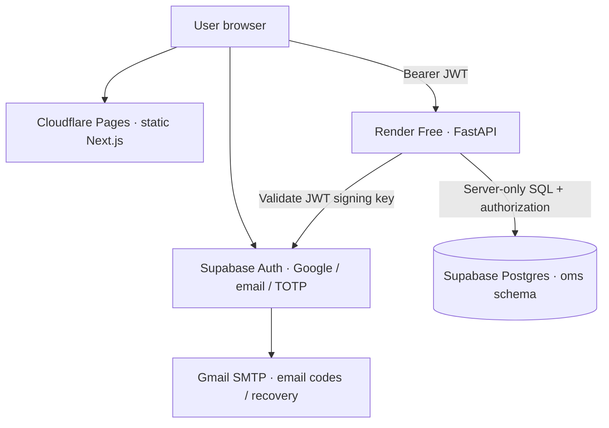

# Uttara OMS
### Uttara Model Thana · Organizational Management System

Personal workspaces. Scoped records. Independent approvals.

[Open application](https://uttara-oms.pages.dev) · [Documentation](docs/index.md) · [User guide](docs/USER_GUIDE.md) · [Developer setup](docs/DEVELOPER_GUIDE.md)

## Current status

**Live, limited free-hosted pilot.** Application baseline: [`f33c8bc`](https://github.com/hossain0707/uttara-oms/commit/f33c8bc783031000bf7885d0c6c591e8f4967580), merged through PR #18. Documentation reviewed **2026-11-22 (Asia/Seoul)**. Production branch is **`main`**. Google login and email-code login have owner-confirmed acceptance; email/password and password-recovery screens are implemented. A deployed pilot and green CI are not a production reliability or security certification. See [deployment evidence](docs/DEPLOYMENT_STATUS.md) and [remaining gates](docs/RELEASE_CHECKLIST.md).

## Explore the system

**[Interactive 3D-style architecture explorer](docs/visuals/architecture-explorer.html)** — clone/download this repository and open that HTML file in a browser. GitHub displays HTML source rather than running it. The self-contained explorer runs offline, provides five workflow tours, pause/step controls, keyboard-accessible service details and reduced-motion support. It uses illustrative activity, never live accounts or telemetry. The GIF above is the README preview; [static SVG](docs/visuals/architecture.svg) is also available.

## What is implemented

| Area | Behavior |
| --- | --- |
| Accounts | Email/password signup and login, email confirmation, password recovery, Google OAuth and six-digit email-code alternative |
| Personal workspace | One Bengali **or** English name, saved profile card, editable addresses, photo, private NID/passport number, reading list and monthly reports |
| Directory | Partial-name search across consented profile summaries and official records; linked people deduplicated; authorized scopes enforced |
| Organization | One Thana → Ward → Unit hierarchy; four official categories; routine edits and independently reviewed sensitive changes |
| Access | Scoped grants/removals, basic-user applications, TOTP gate and protected Master Admin direct account/role/security controls |
| Reports | Personal drafts/submissions/review; assigned targets; historical official counts, movements and authorized PDF/XLSX exports |
| Library | Source-linked BJILibrary syllabus tracks and book covers; explicit reading-list staging, no copied full books |
| Safeguards | Server-side JWT/RBAC, encrypted sensitive fields, version conflicts, append-only history, restricted database runtime role |

**Three distinct concepts:** an authenticated account is not an official member record; a self-reported category is not an approved role; a saved position description does not grant permissions. [Details](docs/architecture.md#three-independent-records).

## Free deployment architecture

The browser uses Supabase for authentication, not direct access to OMS database tables. Photos are encrypted inside profile JSON in PostgreSQL; the available Supabase Storage allowance is not currently used for them. [Architecture](docs/architecture.md) · [Data model](docs/DATA_MODEL.md) · [Free-tier limits and measured burst test](docs/CAPACITY.md).

## Start development

Use a **separate development database and Auth project**, Python 3.12, Node 22 and PostgreSQL 16. Do not copy production secrets or records. Full commands, environment-variable reference, initial-admin provisioning and native PDF dependencies are in the [developer guide](docs/DEVELOPER_GUIDE.md). The shortest route is:

1. Clone the repo, create `apps/api/.env` and `apps/web/.env.local` from the supplied examples; replace every placeholder.
2. Start local PostgreSQL, install the locked API dependencies, run `alembic upgrade head`, then `python -m app.bootstrap init-org`.
3. Run the API on port 8000 and `npm ci && npm run dev` from `apps/web`.
4. Configure development Supabase callbacks, sign in with a synthetic identity and provision the first administrators through the documented offline operator procedure.
5. Run PostgreSQL-backed tests and the web checks before proposing changes.

No real database, SMTP credential, OAuth secret, role grant or owner binding is included in the repository. Existing `render.yaml` is a **historical template pointing to an old branch**; use the current deployment guide when reproducing the live setup.

## Documentation map

| Audience | Start here |
| --- | --- |
| Members | [User guide](docs/USER_GUIDE.md) |
| Administrators and reviewers | [Admin guide](docs/ADMIN_GUIDE.md), [Master Admin](docs/MASTER_ADMIN.md) |
| Developers | [Developer guide](docs/DEVELOPER_GUIDE.md), [API reference](docs/API_REFERENCE.md), [contribution rules](CONTRIBUTING.md) |
| Operators | [Deployment status](docs/DEPLOYMENT_STATUS.md), [operations and recovery](docs/operations.md) |
| Next maintainer | [Handover and continuation plan](docs/HANDOVER.md), [release history](CHANGELOG.md) |
| Reviewers | [QA evidence](docs/qa.md), [security](docs/security.md), [threat model](docs/THREAT_MODEL.md), [release gates](docs/RELEASE_CHECKLIST.md) |

## Capacity and readiness

A short live test completed 50 simultaneous login-page requests and 50 simultaneous database-readiness requests successfully, with median latency around seven seconds from the test runner. It did **not** simulate 50 authenticated users or 1,000 registered users. The initial Python frontend attempt received HTTP 403; a subsequent curl burst succeeded. Full methods, results and limits are retained in [capacity evidence](docs/CAPACITY.md). No user cap was added.

The deployment uses free plans and an owner-managed Gmail SMTP sender. No paid availability, restore capability, monitoring, automatic erasure, key-rotation workflow or 1,000-user capacity certification is claimed. Do not enable paid resources or overages without owner authorization.

## Privacy and rights

Use only for authorized, consensual internal administration. Never commit personal records, identity documents, private photos, database dumps, tokens, authenticator QR secrets or credentials. Security reports should be sent privately to the repository owner, not a public issue.

**License:** no open-source license has been granted for the application; all rights remain with the rights holder unless separately licensed. Access to source does not grant redistribution rights. The bundled geography dataset retains its own [MIT notice](apps/web/data/GEODATA_LICENSE.txt). Library content remains with its source owners.
