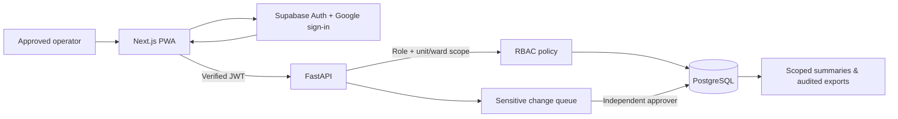

<div align="center">

# Uttara OMS
### Uttara Model Thana — Organizational Management System

**A private-by-default, bilingual-ready administrative platform for structured organizational records.**

[](apps/api)
[](apps/web)
[](docs/architecture.md)
[](docs/security.md)
[](https://github.com/hossain0707/uttara-oms/actions)

**Overview · Member records · Ward & unit hierarchy · Independent approvals · Reporting · Audit trail**

</div>

---

## Current deployment

Updated 2026-11-20 (Asia/Seoul). The limited free-hosted pilot is live at https://uttara-oms.pages.dev with FastAPI at https://uttara-oms-api.onrender.com. **Use `hardening/production-foundation`; default `main` is still the original foundation.** See [current deployment status](docs/DEPLOYMENT_STATUS.md) before deploying.

Google signup/sign-in and personal workspaces are live. **Email OTP delivery is pending custom SMTP and real-code acceptance testing**; the email form remains gated off. Being deployed does not certify production security, reliability or recovery readiness.

## Overview

Uttara OMS organizes administration across **Thana → Ward → Unit**, with four configurable organizational categories: **Rukon (রুকন), Worker (কর্মী), Associate (সহযোগী), Supporter (সমর্থক)**.

The repository is intentionally **application source only**. It must never contain real persons' records, political affiliations, phone numbers, credentials, encrypted database dumps or authorization tokens.

### Features in the initial implementation

| Domain | Capabilities |
| --- | --- |
| Dashboard | Historical active counts by category, ward and unit; date filters, comparison periods and monthly movements |
| Member records | Individual records; lookup by name, member ID and exact normalized phone; duplicate phone detection |
| Hierarchy | Editable names and activation for Thana, Ward and Unit; stable codes; initial 12 ward placeholders |
| Sensitive changes | Category, unit transfer, activation/deactivation require a submitted request and a separate approver |
| Security | Supabase Google SSO, automatic basic accounts, backend JWT verification, scoped role approvals, TOTP for every organizational role |
| Data protection | Fernet encryption for phones/addresses, keyed HMAC phone deduplication, recorded consent attestation, no personal data in system logs |
| Audit | Append-only application audit/event entries; optimistic version checking for member edits |
| Reporting | Authorized aggregate Excel/PDF exports; admin-restricted personal Excel export with audit logging |
| Experience | Responsive Next.js web UI, mobile installable PWA manifest, accessible form controls |

### Architecture



### Authorization model: Option A + C

- **Thana Admin**: global scope, structural changes and approvals. Authenticator MFA is required for every organizational role, including viewers.
- **Thana Responsible Officer**: organization-wide aggregate reports only; cannot access personal profiles, search or individual approval queues.
- **Ward Admin**: read/write within a Ward and its units; approve non-self requests within that Ward.
- **Unit Responsible Officer**: read/write within assigned Unit; submit requests but cannot approve them.
- **Sensitive actions**: category/status/unit transfers are pending until approved by another authorized officer. Cross-ward transfers require Thana Admin approval.
- **Basic accounts**: verified signup creates self-only access to profile, books, personal reports and targets; no official member or role is created.
- **Role provisioning**: users can apply for scoped responsible-person roles; a main admin independently approves. Administrator-initiated permission changes require a separate main admin. Initial admin provisioning is a controlled offline operation.
- **Personal reports**: encrypted and versioned; only the owner and assigned independent reviewer can read them through their authorized endpoints. Main admins assign reviewers and unit-labelled monthly targets.

All permissions are rechecked by the backend; the frontend only provides a user interface.

## Repository layout

```
apps/
  api/
    app/               # Settings, models, JWT auth, RBAC and FastAPI routes
    alembic/           # Version-controlled SQL migrations
    tests/             # API and policy tests
    Dockerfile
  web/
    app/               # Dashboard, directory, structure, approvals, exports
    components/        # Authenticated responsive application shell
    lib/               # Typed API client, Supabase session integration
docs/
  architecture.md
  security.md
  operations.md
  qa.md
.github/workflows/
  ci.yml
docker-compose.yml
```

## Local setup

Requirements: Python 3.12+, Node 22+, Docker with Compose, PostgreSQL 16 (or hosted PostgreSQL), and a **dedicated Supabase project with Google login and asymmetric JWT signing enabled**.

1. Copy `apps/api/.env.example` to `apps/api/.env`; fill values with local-only secrets. Create an encryption key with `python -c "from cryptography.fernet import Fernet; print(Fernet.generate_key().decode())"`. Use a different long random key for `PHONE_HASH_KEY`.
2. Set `LOCAL_DB_PASSWORD` in your shell and run `docker compose up -d db`. Set `DATABASE_URL` to `postgresql+psycopg://oms:<password>@localhost:5434/oms` for local Python (or `@db:5432` inside Compose).
3. From `apps/api/`, install `pip install -r requirements.lock` and run `alembic upgrade head`.
4. Initialize **organizational nodes only**, no people: `python -m app.bootstrap init-org`.
5. Configure a dedicated Supabase Google OAuth project and permitted redirect URLs; sign in once with the intended admin Google account. Get the exact Supabase `auth.users.id` (JWT `sub`) through an authorized Supabase admin interface. Provision it locally with `python -m app.bootstrap admin --sub <auth-sub-uuid> --email <email>`. This is an offline privileged operation; enable Supabase MFA for this identity before using the app.
6. Run `uvicorn app.main:app --reload` in `apps/api/`.
7. Copy `apps/web/.env.example` to `apps/web/.env.local` and set the public Supabase project URL/publishable key and backend URL. From `apps/web/`, run `npm ci && npm run dev`.
8. Open http://localhost:3000 and use Google sign-in. Verified users get a basic personal workspace automatically; approved roles unlock organizational access and require MFA. Configure a separate development Auth project and localhost redirects.

**Important:** OAuth alone never confers organizational access. Automatic registration creates `app_users` only; approved `role_grants` and required MFA control organizational data access. Keep `NEXT_PUBLIC_EMAIL_OTP_ENABLED=false` until SMTP, both Token-based email templates and delivered-code tests are ready. Pages and Docker/Compose consume this flag at build time; rebuild after changing it.

## Testing

```bash
cd apps/api
pytest -q

cd ../web
npm ci
npm run lint
npm test
npm run build
```

See [implementation plan](docs/IMPLEMENTATION_PLAN.md), [project status](docs/PROJECT_STATUS.md), [release checklist](docs/RELEASE_CHECKLIST.md), [architecture](docs/architecture.md), [security and privacy](docs/security.md), [operations](docs/operations.md), and [QA checklist](docs/qa.md).

## Release status

**Live free-hosted pilot — not certified production-ready.** Automated integration/build/security/container checks passed for the released implementation. Privacy/legal review, independent security review, backup/restore testing, operational monitoring and full acceptance remain required. Production secrets are managed separately and are not supplied in source control.

The software must be used for consensual internal administration, **not** individual political profiling, campaign targeting, or unauthorized sharing of personal data.

**License:** No open-source license has been granted. All rights reserved by the repository rights holder unless a separate license is supplied.


## Historical reporting and upgrade

Dashboard and aggregate exports accept inclusive `start_date` / `end_date` in Asia/Dhaka. Counts reflect the selected end date; movements and monthly summaries reflect the selected interval. Category changes preserve overall counts, and historical transfers stay in their original unit scope. Personal exports contain **current** records. See the exact accounting and legacy backfill rules in [architecture](docs/architecture.md).

Before upgrading a populated environment: stop writes, back up the database and keys separately, restore into staging, run `alembic upgrade head` and `alembic check`, and reconcile scoped totals. Migrations reject incomplete history rather than invent historical counts. Do not bypass that failure without a reviewed reconciliation. The source and tested dependency locks contain no real records.

For PostgreSQL integration tests set a dedicated synthetic `TEST_DATABASE_URL` whose user may create/drop schemas, then run `python -m pytest -q`. Each integration/migration fixture creates an isolated schema. **Never point this at a production database.** CI supplies a disposable PostgreSQL 16 service. Local runs without it use SQLite and skip the PostgreSQL locking case.
