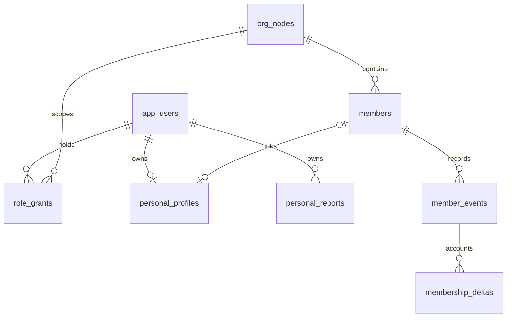

# Data model and privacy boundaries

Source of truth: [models.py](../apps/api/app/models.py), [migrations](../apps/api/alembic/versions/), route serializers and authorization checks. Deployed head: `0005_personal_workspace`, application schema `oms`. Development can use a separate default schema.

## Tables

| Table | Purpose / important invariants |
| --- | --- |
| `org_nodes` | THANA → WARD → UNIT, parent/code uniqueness, one Thana root |
| `app_users` | Unique verified Auth subject; internal UUID; email; active flag |
| `role_grants` | Account + role + scope; uniqueness includes null-scoped global grants |
| `members` | Unique external member number and normalized phone digest; official category, unit, status, version |
| `change_requests` | Sensitive member proposals; expected member version; pending/reviewed state; requester/reviewer |
| `access_requests` | Grant/revoke applications, Auth subject, role/scope, independent decision |
| `member_events` | Append-only member transition and actor history |
| `membership_deltas` | Append-only scoped +1/-1 active-count ledger tied to events |
| `audit_logs` | Append-only actions; also authoritative owner/security-policy events |
| `personal_profiles` | One row per account, encrypted profile/goals JSON, optional reviewer, unique member link, version |
| `personal_reports` | Unique account/month, encrypted entries/summary/goals/review note, status and version |

Diagram omits auxiliary foreign keys for clarity; it is not generated DDL. Reviewer assignments reference a different active account with an organizational grant. The member link is managed by a Thana Admin, never trusted from a self-requested unit.

## Encryption and visibility

| Data | At-rest representation | Application visibility |
| --- | --- | --- |
| Password / TOTP seed | Managed by Supabase Auth; not OMS profile fields | Auth provider; no OMS API password storage |
| Official name, category, status, unit, occupation | SQL columns | Approved official-record scope; aggregates exclude names |
| Official phone/address | Fernet ciphertext; phone also keyed HMAC digest | Authorized record views; selected official phone fields in Thana Admin export |
| Personal profile/name/photo/books | Fernet-encrypted JSON | Owner; assigned reviewer projection; minimal directory projection by scope |
| Legacy NID/passport | Older encrypted profile JSON may contain these keys | Excluded from every profile response and discarded on subsequent profile/reading saves; no new collection or display |
| Report entries, summary, goal snapshot, review note | Fernet ciphertext | Owner and assigned independent reviewer through authorized endpoints |
| Current target assignment | Encrypted goal JSON | Owner and assignment-managing Thana Admin |
| Owner / MFA policy | Limited JSON in append-only audit detail | Authorized security endpoints; not a browser-editable flag |

Encryption is application-level field protection, not a claim of anonymous records or encryption of every SQL column. The API process holds decryption capability; privileged database/provider operators have separate responsibilities. Losing the Fernet key loses decryptability; replacing the HMAC key without migration breaks phone matching. Back up matching keys separately from the database.

## Contracts developers must preserve

- UUIDs are internal identifiers; member number and Auth subject are distinct identifiers.
- Writes reject unknown fields and use `expected_version`; 409 is a reconciliation signal.
- Profile and reading saves are separate sections; reading-only saves cannot overwrite identity or other profile fields.
- Consent is required for profile/report saves and attested official creation. No synthetic consent on real users' behalf.
- Directory sharing checkbox controls photos, not administrative permission. Minimal consented profile summaries are available to Thana Admins as described to the user.
- Report months use the first day; daily entries belong to that month and cannot be future dates (Asia/Dhaka).
- Historical official headcounts come from event-scoped deltas, not personal profiles or current member categories alone.
- Histories are append-only with PostgreSQL triggers and restricted runtime grants. Do not `UPDATE`, `DELETE`, `TRUNCATE` or `FOR UPDATE` immutable audit rows.
- Schema owner is separate from runtime; migrations require privileged, reviewed operations. There is no automated data-erasure or encryption-key-rotation tool yet.
