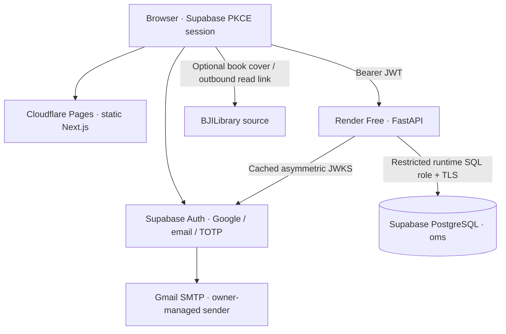
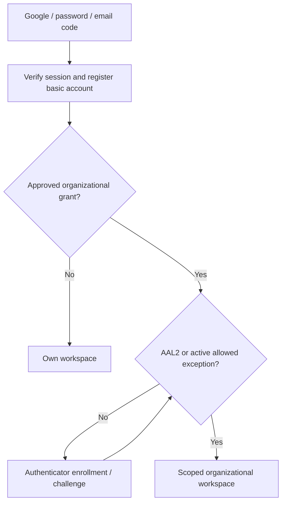
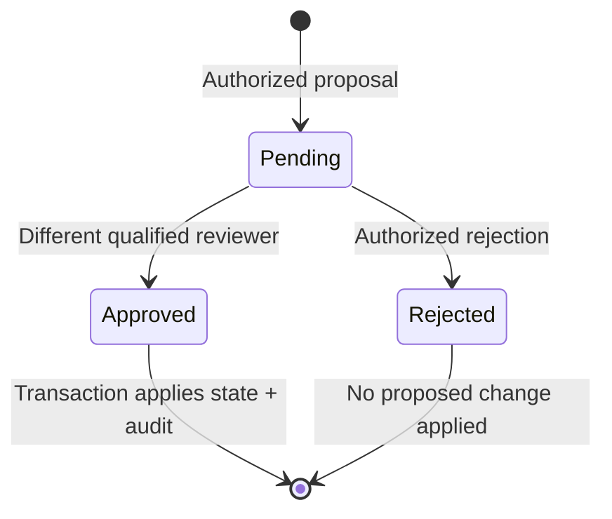
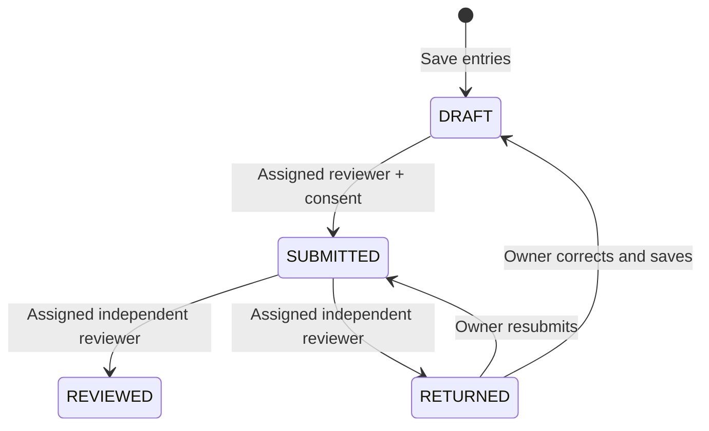

# Architecture and workflow

Reviewed against `f33c8bc` (PR #18), 2026-11-22. [Interactive 3D-style explorer](visuals/architecture-explorer.html) · [Static overview](visuals/architecture.svg) · [Data model](DATA_MODEL.md).

## Deployment topology

Cloudflare serves compiled HTML/JS/CSS; it does not run the API or hold database secrets. The browser talks directly to Supabase Auth for identity and to FastAPI for OMS data. FastAPI validates asymmetric JWTs, resolves the active account, roles, MFA policy and scope before querying PostgreSQL. Its DB connection is server-only. Supabase anonymous/authenticated browser roles do not have OMS table access. The runtime role's RLS policies permit server operations; end-user isolation is enforced by FastAPI, not by per-user database JWT claims.

Gmail SMTP is configured in Supabase; passwords, codes and recovery requests do not pass through an OMS mail server. Google OAuth is a distinct login method from receiving an email code at a Gmail address. Library metadata is a local reviewed snapshot; only external cover requests and explicitly opened source links leave the app for that source. There is no live syllabus synchronization or remote search API.

## Three independent records

| Concept | Persistence | Authority |
| --- | --- | --- |
| Account | `app_users`, bound to verified Auth `sub` | Login identity and active/suspended state |
| Personal profile | `personal_profiles` encrypted details | Owner-supplied name, identification, photo, self-reported category, books; optional approved member/reviewer links |
| Official member / permission | `members` and `role_grants` | Official category/unit/status and separately approved administrative powers |

Signup creates a self-only account, not an official member or administrative grant. One name field accepts either Bengali or English. A profile's category, occupation, requested unit or responsibility label never grants a role or changes official headcounts.

## Identity and authorization workflow

The owner always needs AAL2. Administrative exceptions are server-side policies with expiry/revocation; ordinary authentication and role/scope checks remain. JWT checks enforce signature, `exp`, `iat`, subject, issuer, audience and authenticated role. User-editable metadata is not an authorization source. Suspended accounts are denied on subsequent requests. The browser persists Supabase session tokens in provider-managed browser storage; there is no implemented server-cookie session layer or offline data synchronization.

## Independent approval workflows

This state diagram describes ordinary member/access requests. Role changes created by an administrator need a different Thana Admin for approval. Ward member decisions stay inside their ward; cross-ward transfers need global authority. All decisions recheck scope, current state and version. Security-exception requests are separately event-sourced: owner requests; a different AAL2 Thana Admin who is not the target approves. Owner can revoke immediately. Rejection permissions differ by request type; use [the admin guide](ADMIN_GUIDE.md) and actual route checks rather than assuming every requester can reject every queue.

## Personal report workflow

Submitted/reviewed reports cannot be edited directly. Goal values are snapshotted from the current assignment on each report save. The assignment is not a historical per-month target scheduler. Only owner and assigned independent reviewer endpoints expose private report content; global administrators manage assignment metadata without automatic report access. Document numbers are excluded from reviewer views and exports.

## Unified directory projection

`/directory` combines official members and consented personal summaries. Thana Admins see unlinked summaries; ward/unit staff see only officially linked members within approved scope. Linked people appear once. Normalized partial matching preserves the original display name; cross-script transliteration is not implemented. Official category/status filters remain authoritative on member records. Photos need opt-in except the owner's own view. Unlinked summaries exclude contact details, addresses, document numbers, books and private reports.

Matching currently decrypts authorized profile rows server-side and sorts/paginates the unified result. It is not a large-scale indexed encrypted search service. [Full contract](DIRECTORY_SEARCH.md).

## Implementation boundaries

- Application is single-Thana, not a multi-tenant product.
- One synchronous Uvicorn worker by the Docker command; SQLAlchemy default pool with pre-ping/recycle, not a measured autoscaling configuration.
- Personal JSON, photos, goals and reports are Fernet-encrypted in Postgres. Official names/categories and operational metadata are ordinary SQL columns; do not claim all fields or all names are encrypted.
- Photo data is not stored in a public bucket. Normal uploads are re-encoded JPEGs with metadata removed.
- Readiness checks SQL connectivity and exact Alembic revision `0005_personal_workspace`, not Auth/email delivery or end-to-end business health.
- Audit logs contain identifiers/actions and limited detail; keep personal text and secrets out of reasons and operator logs. Security policy audit events are durable authority, not disposable telemetry.
- PWA manifest does not imply offline operation, encrypted offline storage or push notifications.

## Membership ledger and reporting contract

`membership_deltas` references `member_events`, stable unit IDs, category, signed active-person delta and UTC event time. Creation inserts +1; deactivation -1; reactivation +1; category change inserts -1/+1 in the same unit; active transfer inserts -1/+1 across units. Inactive transfers/category changes have no active-count delta. Rows are inserted in the same transaction as member state, event and approval. PostgreSQL triggers reject UPDATE/DELETE on events, deltas and audit logs; runtime DB privileges must also deny TRUNCATE/DDL.

Dashboard and aggregate exports accept `start_date` and `end_date` (ISO dates, inclusive, Asia/Dhaka calendar). Defaults: current month through today. At most 367 days per request; future end dates and reversed ranges are rejected. Counts are as of end-of-day, and movement is scoped to units **before** grouping by event. Therefore a cross-scope transfer is one exit/entry, while a global transfer or category change adds no people. Comparison uses the immediately preceding equal number of calendar days. Monthly history clips first/last months to the selection. `this_month` remains calendar-month-to-date for compatibility; new clients use `period`.

Personal export is always current state and is explicitly labeled as such, even with historical aggregate filters. Reports use current organizational names. No person names or contact data enter the aggregate ledger. PostgreSQL report queries use a separate read-only REPEATABLE READ transaction so totals, movement and comparisons share one committed snapshot. This temporarily requires a second pooled connection per report request; include it in pool/load sizing. SQLite uses the test session and does not prove PostgreSQL isolation.

Migration 0003 reconstructs legacy deltas by reversing recorded transitions from each current member. It rejects missing creation, inconsistent transition values, unknown actions or ambiguous history rather than guessing. Migration 0004 adds uniqueness barriers for a single Thana, null-scoped global grants and one pending request per member/change type. Duplicate legacy data must be reviewed before upgrade; migrations never silently discard it.

## Write coordination

Structural writes, member creation, sensitive proposals/decisions and access changes lock the Thana root before entity rows. Routine member updates lock the member row before checking `expected_version`. This intentionally serializes high-risk writes for this initial single-Thana deployment. PostgreSQL locking must be verified by CI; SQLite is only a fast regression environment. Plan a measured redesign if throughput makes the root lock a bottleneck. The first root is protected by a unique partial index.
