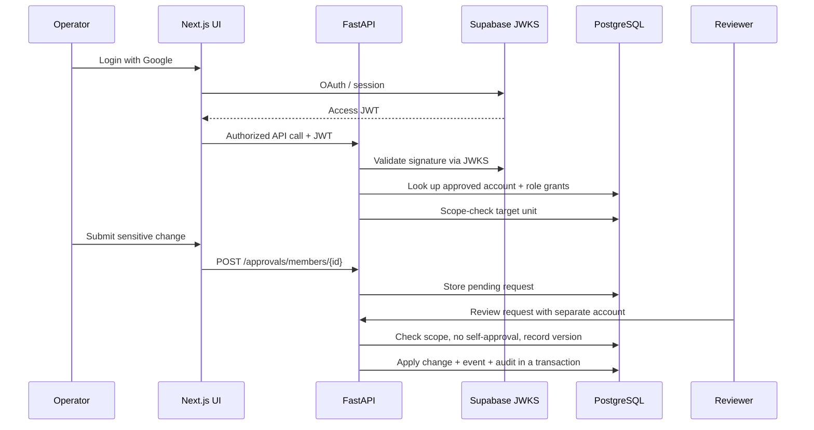

# Architecture and data lifecycle

## Bounded contexts

- **Identity:** Supabase Google OAuth authenticates the user; PostgreSQL `app_users` and scoped `role_grants` separately authorize OMS access.
- **Organization:** `org_nodes` stores a single Thana root, editable Wards and Units. Only active Units can receive new profiles.
- **Directory:** `members` is the current materialized record; `member_events` records transitions; `audit_logs` records responsible actors without copying sensitive fields.
- **Review:** `change_requests` stores pending critical mutations, expected entity version and independent decision.
- **Analytics:** SQL aggregation of immutable, event-scoped membership deltas; category transitions and transfers within a reporting scope conserve total people.
- **Export:** aggregate reports available by scope; personal exports require Thana Admin role and are recorded in audit logs.

## Workflow

## Data contracts

- UUID identifiers at all levels; stable external member ID is separately unique.
- Four categories: `RUKON`, `WORKER`, `ASSOCIATE`, `SUPPORTER`.
- `ACTIVE` and `INACTIVE` state in initial version.
- One unit per member at a time; transfers recorded as historical events.
- Time and actor retained on approvals and all creation/routine edit actions.
- Application-level phone encryption and an HMAC digest for exact match/duplicate detection.
- Source-of-truth: PostgreSQL only; frontend must never persist organizational records to local storage.

## Known limitations

- Historical counts use event time and original unit/category. Organizational names and role scopes use the current hierarchy; renamed wards are not historically versioned. Joined-on dates are descriptive and never backdate ledger events.
- Access UI supports independently approved grants/revocations; only initial administrators use offline bootstrap.
- No retention/deletion workflow or key rotation support yet.
- Administrator TOTP enrollment/challenge is available at the access gate. Invitation, recovery, and MFA reset remain controlled identity-provider operations.
- PDF renders aggregated data only; personal PDF export intentionally not enabled.

## Membership ledger and reporting contract

`membership_deltas` references `member_events`, stable unit IDs, category, signed active-person delta and UTC event time. Creation inserts +1; deactivation -1; reactivation +1; category change inserts -1/+1 in the same unit; active transfer inserts -1/+1 across units. Inactive transfers/category changes have no active-count delta. Rows are inserted in the same transaction as member state, event and approval. PostgreSQL triggers reject UPDATE/DELETE on events, deltas and audit logs; runtime DB privileges must also deny TRUNCATE/DDL.

Dashboard and aggregate exports accept `start_date` and `end_date` (ISO dates, inclusive, Asia/Dhaka calendar). Defaults: current month through today. At most 367 days per request; future end dates and reversed ranges are rejected. Counts are as of end-of-day, and movement is scoped to units **before** grouping by event. Therefore a cross-scope transfer is one exit/entry, while a global transfer or category change adds no people. Comparison uses the immediately preceding equal number of calendar days. Monthly history clips first/last months to the selection. `this_month` remains calendar-month-to-date for compatibility; new clients use `period`.

Personal export is always current state and is explicitly labeled as such, even with historical aggregate filters. Reports use current organizational names. No person names or contact data enter the aggregate ledger. PostgreSQL report queries use a separate read-only REPEATABLE READ transaction so totals, movement and comparisons share one committed snapshot. This temporarily requires a second pooled connection per report request; include it in pool/load sizing. SQLite uses the test session and does not prove PostgreSQL isolation.

Migration 0003 reconstructs legacy deltas by reversing recorded transitions from each current member. It rejects missing creation, inconsistent transition values, unknown actions or ambiguous history rather than guessing. Migration 0004 adds uniqueness barriers for a single Thana, null-scoped global grants and one pending request per member/change type. Duplicate legacy data must be reviewed before upgrade; migrations never silently discard it.

## Write coordination

Structural writes, member creation, sensitive proposals/decisions and access changes lock the Thana root before entity rows. Routine member updates lock the member row before checking `expected_version`. This intentionally serializes high-risk writes for this initial single-Thana deployment. PostgreSQL locking must be verified by CI; SQLite is only a fast regression environment. Plan a measured redesign if throughput makes the root lock a bottleneck. The first root is protected by a unique partial index.
