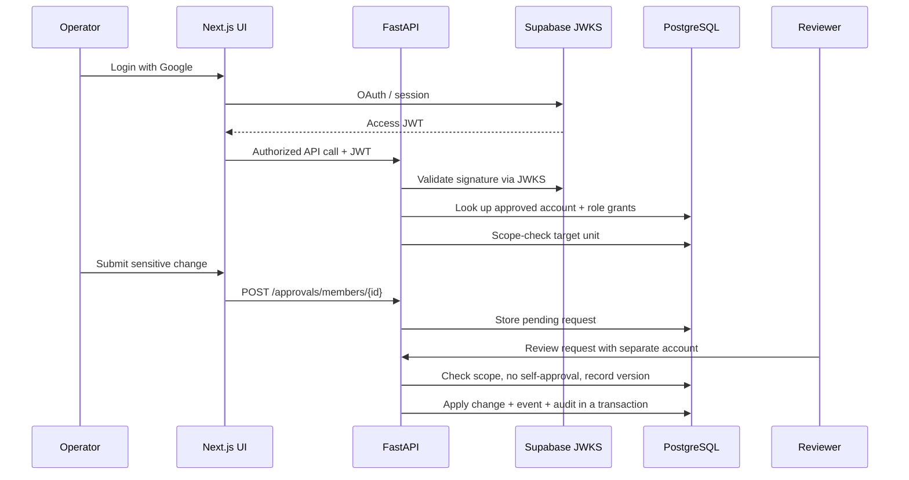

# Architecture and data lifecycle

## Bounded contexts

- **Identity:** Supabase Google OAuth authenticates the user; PostgreSQL `app_users` and scoped `role_grants` separately authorize OMS access.
- **Organization:** `org_nodes` stores a single Thana root, editable Wards and Units. Only active Units can receive new profiles.
- **Directory:** `members` is the current materialized record; `member_events` records transitions; `audit_logs` records responsible actors without copying sensitive fields.
- **Review:** `change_requests` stores pending critical mutations, expected entity version and independent decision.
- **Analytics:** aggregated counts computed from accessible current rows; category transitions are not treated as new persons.
- **Export:** aggregate reports available by scope; personal exports require Thana Admin role and are recorded in audit logs.

## Workflow

## Data contracts

- UUID identifiers at all levels; stable external member ID is separately unique.
- Four categories: `RUKON`, `WORKER`, `ASSOCIATE`, `SUPPORTER`.
- `ACTIVE` and `INACTIVE` state in initial version.
- One unit per member at a time; transfers recorded as historical events.
- Time and actor retained on approvals and all creation/routine edit actions.
- Application-level phone encryption and an HMAC digest for exact match/duplicate detection.
- Source-of-truth: PostgreSQL only; frontend must never persist organizational records to local storage.

## Known limitations

- Month-to-date movement is event-based, and existing event scope follows the member's **current** unit. Historical ward-by-ward reconstruction needs an as-of ledger before official historical reconciliation.
- No automated role management UI yet. Provision roles via controlled offline processes.
- No retention/deletion workflow or key rotation support yet.
- No invitation, MFA enrollment or account recovery UI; use the identity provider's controlled facilities.
- PDF renders aggregated data only; personal PDF export intentionally not enabled.
